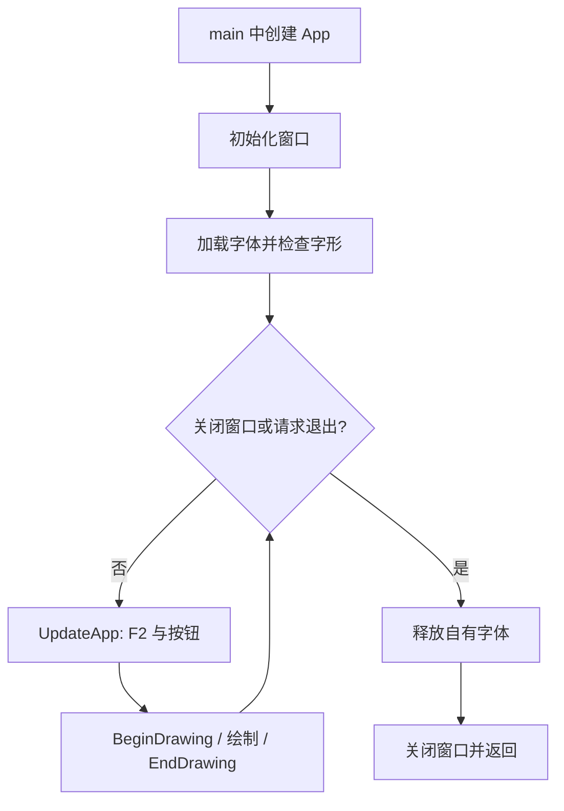

# 第一阶段：窗口、构建与双语

本文保留第一阶段的学习记录。当前程序已进入第二阶段，请以 STAGE2.md 和 README 为准；绘制入口已从 DrawStageOneUi 演进为 DrawUi，App 也新增地图、玩家与界面状态。

## 当前成果

1024×768 窗口；中英文切换；鼠标悬停/选中按钮；安全退出；字体可用性检查。
所有几何装饰只是占位，不是地图。没有角色移动、战斗、交易或存档。
第一阶段语言设置只存在内存中，重启默认中文；阶段 7 再持久化。

## 文件与职责

| 文件 | 作用 |
|---|---|
| `main.c` | 创建窗口和局部 App；输入→绘制循环；退出释放 |
| `app.h / app.c` | 状态记录、初始化、语言检查、每帧输入 |
| `text.h / text.c` | enum 定义语言/文字 ID；本地二维数组查找双语文字 |
| `assets.h / assets.c` | 定位字体、收集 UTF-8 字符、检查字形、加载/释放 |
| `ui.h / ui.c` | 按钮命中、按钮状态、文字布局与绘制 |
| `scripts/build.ps1` | 查找当前源文件、严格编译、链接 raylib |

## 核心结构

### 状态与参数

`App app = { 0 };` 在 main 内创建应用状态，没有全局变量。
`InitializeApp(&app)` 传入地址，让函数能修改同一份状态；`app->language` 表示通过指针访问字段。
`DrawStageOneUi(const App *app)` 只读取状态，const 防止绘制函数误改游戏数据。

头文件提供类型和函数声明；各 .c 提供实现。`static` 函数只供所在源文件调用，不代表全局状态。

### 主循环

初始化只执行一次。循环每帧先处理输入、再绘制；退出后释放资源一次。
`SetTargetFPS(60)` 限制目标帧率，不等于未来的移动速度；移动阶段会用时间差计算距离。
窗口关闭按钮与应用退出按钮都会结束循环。
`SetExitKey(KEY_NULL)` 避免 raylib 默认的 Esc 退出，以便后续统一处理暂停和保存。

### 双语与字体

`Language`、`TextId` 是自定义枚举，给有限选项起名字。
`GetUiText` 内的二维数组按语言与 ID 索引；它是自动局部数组，不是全局或 static 数据。
新增 UI 文字应在两种语言中一起补齐。

UTF-8 中一个汉字可能占多个字节，所以不能把每个 char 当成一个汉字。
`GetCodepointNext` 解析 Unicode 字符；收集函数去重并检查容量，最终只把需要的字形放入字体图集。
加载后再验证每个字形，不完整则回退英文。
资源路径从可执行文件位置计算，因此换终端工作目录仍能定位项目字体。

**当前字体：** 项目已提供 Noto Sans CJK SC Regular 及其授权，全部 183 个所需字形通过检查。
初次测试发现本机 Noto Sans TC 缺少 17 个简体字，曾临时使用系统黑体；现已替换为项目内字体。
正常运行不再依赖系统字体；系统黑体仅保留为项目字体丢失时的开发回退。

### 鼠标按钮

`IsMouseButtonPressed` 只在按下那一帧成立，避免按住重复执行。
`CheckCollisionPointRec` 检查鼠标点是否在按钮矩形内；绘制与输入共用同一个矩形计算函数。
悬停和选中只是显示状态；语言不可用时按钮禁用。

## 第一阶段数据字典

| 类型/字段 | 含义 | 合法值与所有权 |
|---|---|---|
| `Language` | 当前语言 | English / Chinese，COUNT 仅用于遍历 |
| `TextId` | UI 文字标识 | 小于 TEXT_COUNT；无效 ID 返回提示文本 |
| `App.language` | 当前显示语言 | 中文只能在字形完整时启用 |
| `App.assets` | 字体资源记录 | 随 App 存在 |
| `App.exitRequested` | 点击退出的请求 | bool |
| `UiAssets.font` | raylib 字体与纹理 | 自有字体或 raylib 默认字体 |
| `UiAssets.ownsFont` | 是否需要自行释放 | 自有为 true；默认字体不能自行释放 |
| `UiAssets.supportsChinese` | 是否通过全部字形检查 | bool |
| `UiAssets.usesSystemFont` | 是否依赖开发机字体 | true 时还不能视为资源独立的提交包 |

## 你应亲自验收

1. VS Code 打开项目目录，Ctrl+Shift+B 构建，F5 调试。
2. 在 `UpdateApp` 中设置断点，点击按钮后确认程序停住；查看 `app->language`，继续运行。
3. 分别点击 English 与中文；所有文字应切换，中文无方框、按钮文字不越界。
4. 按 F2 多次；窗口内输入与 VS Code F5 调试是不同操作。
5. 鼠标悬停三个按钮；按住语言按钮不应反复触发。
6. 点击退出、重新运行，再用窗口 X 关闭；Esc 不应直接结束。
7. 从其他工作目录启动 `bin/project-lax.exe`，字体仍应正确定位。
8. 正常运行不应再出现“开发字体”提示；提交包需要包含 assets/fonts 内的字体和授权。

## 学习练习

- 在 text.c 改一句中英文说明，重新构建并观察。
- 解释为什么 `UpdateApp` 接收 `App *`，绘制接收 `const App *`。
- 指出初始化、每帧执行、退出释放分别在哪里。
- 解释为什么只在窗口初始化后加载字体，以及为什么默认字体不由我们释放。

## 自动检查入口

`bin/project-lax.exe --smoke-test` 创建隐藏图形窗口，分别渲染两种语言并将截图保存到 bin，之后退出。
它检查 OpenGL 初始化、全部所需字形与截图导出；失败返回非零。
它不代替真实按钮点击、VS Code F5 和断点验收。使用前必须完成构建。

## 已执行的验证（2026-10-12）

- Debug 与 Release 均通过严格编译，最终保留带调试符号的 Debug 可执行文件。
- 从项目之外的 `D:/raylib` 工作目录执行隐藏窗口检查，退出码为 0。
- OpenGL 3.3 初始化成功；全部 183 个所需字形存在；中英文截图成功导出。
- 已目视检查 `bin/stage1-en.png` 与 `bin/stage1-zh.png`：文字完整，按钮标签没有越界。
- GDB 成功加载调试符号，将 `UpdateApp` 断点定位到 app.c；UTF-8 字符集设置消除了初次编码警告。
- VS Code 三个 JSON 配置均通过 JSON 解析；应用源码没有 goto 或全局变量。
- 尚需用户亲自验证真实鼠标操作、F2、VS Code F5 和运行时断点。未声称完成后续阶段。
- 后续字体验证：已下载官方简体字体及授权，从项目外工作目录重新运行，全部 183 个字形通过；无系统字体回退，退出码为 0。
- 字体资源已齐备，但最终游戏提交包仍需等后续阶段完成后整理。
