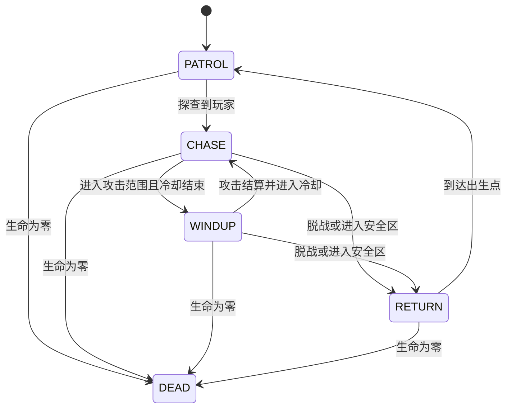

# 第四阶段：哥布林行为与脱战（2026-10-13）

本文保留第四阶段的学习记录。当前第五阶段已加入奖励、等级、背包和交易，请以 STAGE5.md 为准；怪物行为仍保留独立检查。

## 已实现与范围

野外四只近战、两只远程哥布林。出生点附近固定巡逻点、八向 BFS 绕障碍、当前地图全图追击、近战预警、远程后退及锁定方向射击、五秒脱战、返回出生点、进入安全区立即重置。
角色和怪物现在共同按脚底 Y 排序，贴图仍为占位。没有金币经验、任务、装备商店、Boss 战斗或存档。

## 新文件与职责

- `enemy_ai.h / enemy_ai.c`：集中处理敌人状态、感知、巡逻、寻路、追击和返回。
- `tests/test_enemy_ai.c`：验证全图绕障碍、集体脱战计时、安全返回与远程行为。
- 原有 combat 模块继续处理伤害/投射物；world 模块接收通用 WorldActor 绘制记录，不读取 Combat。
- TestEnemy 改名 Enemy；所有状态仍放在 main 的局部 App 中，没有全局变量或 goto。

## 状态机



返回途中不探查、不攻击；到达出生点后恢复正常巡逻和探查。安全区事件也会让正在巡逻的存活敌人返回。
未重新加载地图时，死亡敌人不会复活，受伤敌人也不会回满血。

## 核心逻辑怎样工作

### 探查与五秒脱战

先遍历所有活敌人：距离不超过 160 像素、墙体无遮挡、玩家不在安全区且敌人不在返回，才算探查成功。
探查成功更新该敌人的 lastSeen 和 engaged；任何一只成功就将全局 lostTimer 清零并设置 inCombat。
没有敌人探查，但仍有已交战敌人时，lostTimer 累加；达到五秒取消攻击并让交战敌人返回。
倒计时期间只追向 lastSeen，不偷看玩家现在的位置。重新被另一只敌人发现也会清零。
仍在飞行的敌方投射物也作为威胁，避免有敌方飞弹时错误显示和平；最后敌人/飞弹都消失后可以结束战斗。
暂停、对话与死亡会冻结世界和计时。进入安全区立即结束战斗并清除敌方攻击，不等五秒。

### BFS 怎样绕过障碍

地图的每个格子是一个节点；用本地数组作为队列和 parents 记录，逐层搜索八个邻居。
节点必须容纳敌人身体，且不能与安全区相交；斜向相邻的两个直向节点也必须可走，禁止抄墙角。
找到目标后沿 parents 回溯到第一步；目标不可达时选择搜索中最接近目标的可达节点。
实际移动仍连续：走向下一格的中心，分为最多四像素的步长逐次碰撞检查。
只有目标格改变、到达路点或 0.35 秒刷新时间到期才重新寻路，不每帧重建路径。
检查从实际位置到下一节点的短路径；若会撞障碍，先对齐当前格子中心。

### 两类敌人怎样攻击

近战：进入 48 像素范围后停止，留下固定橙色矩形；预警结束只结算一次，玩家移出或躲到障碍后可避免受伤。
远程：过近（64 像素内）尝试退到较远的位置；无法移动时允许原地应战。160 像素内且无遮挡时停止并预警，锁定方向发射橙色飞弹，不自动追踪。
飞弹速度 160 像素/秒、射程 256 像素、伤害 12；碰墙、安全区或玩家后消失，不伤害其他怪物。
玩家蓝色法术只命中怪物；方向、冷却与之前阶段一致。

### 巡逻与返回

出生点周围四个巡逻目标：右、下、左、上各偏移一格，移动后短暂停留；无效目标跳过。
巡逻用每秒一格，追击/返回每秒两格，玩家每秒三格，保留逃离空间。
返回使用同一套 BFS，HP 保留。回到出生点短暂停留后重新巡逻。怪物彼此不做实体碰撞，避免拥挤卡死。

## 数据字典与参数

| 数据 | 含义 |
|---|---|
| Enemy.kind / state | 近战或远程；巡逻/追击/预备/返回/死亡 |
| Enemy.spawn / position | 出生点与当前脚底坐标 |
| Enemy.engaged / lastSeen | 是否已交战，最后观察到的玩家位置 |
| Enemy.waypoint / pathTimer / goalCol / goalRow | 当前路点、路径刷新秒数和目标格 |
| Enemy.patrolPoint / patrolPause | 当前巡逻目标编号和停留计时 |
| Enemy.attackDirection / attackArea | 锁定远程方向或近战区域 |
| Combat.inCombat / lostTimer / wasSafe | 战斗状态、丢失探查计时、上一帧是否安全 |
| Projectile.hostile / damage | 敌方/玩家所属和伤害；防止混淆命中对象 |
| WorldActor | 只携带绘制用位置和颜色，便于一起 Y 排序 |

主要候选参数在 InitializeCombat 的 CombatRules：enemySpeed=64、detectionRange=160、disengageDelay=5。
远程维持距离/射程等第一版常量在 enemy_ai.c / FireEnemyProjectile 中，平衡阶段再统一整理，不是最终数值。

## 亲自验收

1. 构建并进入野外；绿色是近战，棕色是远程。安全区内观察它们巡逻，玩家不受伤。
2. 靠近一只：HUD 变为战斗中；它停止巡逻，沿地图追击。尝试利用树干、石头和中间墙，让它绕行。
3. 近战橙色方框出现后移出，应该躲开；站住应受伤，身体接触本身不扣血。
4. 找棕色敌人（例如野外坐标约 432,784）：观察后退、橙色瞄准线和飞弹；射击预警后换方向移动可躲开。
5. 逃离所有怪物或利用障碍遮挡，HUD 出现五秒倒计时；五秒内重新被任意一只发现，倒计时归零。
6. 脱战后敌人返回原位，途中不攻击；到位再巡逻。追击不受出生点距离限制，但不能跨地图。
7. 回到绿色 3×3 区域：立即和平、飞弹消失、敌人返回；玩家不自动回血，需要交互治疗点。
8. 先击伤或杀死一只，再进安全区：受伤者不回满血，死者不复活。切图或死亡复活才重建普通怪物。
9. 观察怪物从建筑/树冠前后经过，遮挡排序正确；敌人名称和血条作为标注绘制在其上方。
10. 暂停时所有行为和脱战倒计时停止；死亡选择和语言切换仍正常。

## 自动检查

```powershell
powershell.exe -NoProfile -ExecutionPolicy Bypass -File .\scripts\build.ps1 -Configuration Debug -CheckMovement -CheckCombat -CheckAI
```

已有战斗测试固定 enemySpeed=0 且只保留一个敌人，以隔离命中逻辑；AI 测试使用实际移动逻辑，不把测试开关放进正式游戏。
AI 检查覆盖：巡逻、初次发现、五秒丢失、任意第二敌人重置、安全返回、返回不攻击、保留 HP、绕墙跨出生区、禁止斜穿角落、远程退后、锁定射击、飞弹伤害、死者不复活。
图形检查新增六张 bin/stage4-*.png；已运行通过，284 个所需字形完整，中英文状态与远程效果画面未越界。

## 学习练习

- 在 UpdateEnemyAI 断点观察 state、engaged、lastSeen、lostTimer，解释这四者为什么不同。
- 将 detectionRange 从 160 改为 128，试玩后解释对发现距离和脱战难度的影响。
- 解释为什么返回状态跳过探查，为什么五秒计时不能每个敌人各算各的。
- 在 FindEnemyWaypoint 观察 queue 和 parents，说明如何找到绕墙的第一步。

本阶段验收后进入阶段 5：击杀奖励、等级、背包、装备和商店，不提前加入 Boss 或存档。
