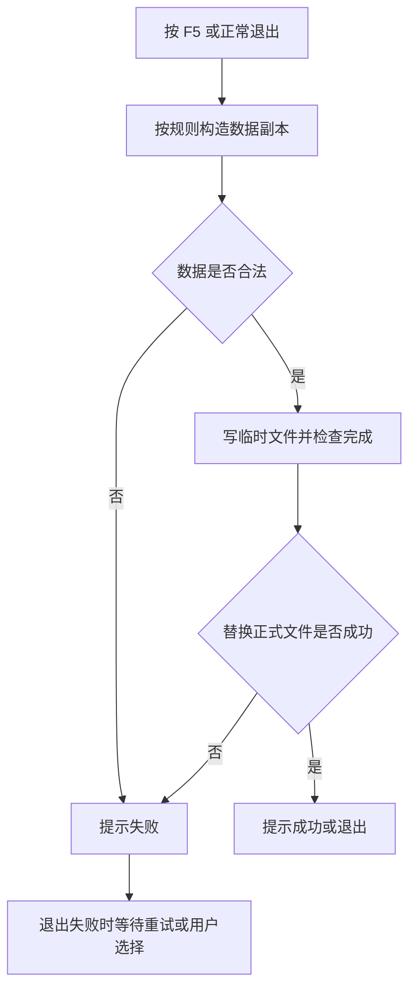

# 第七阶段：存档与继续游戏（2026-10-14）

## 版本 2 更新（2026-11-02，当前实现）

本节取代下方版本 1 的退出位置和恢复规则；下方保留早期实现记录，便于理解开发过程。

- 和平且存活时允许 F5；正常退出在战斗中也保存原地图、坐标与现场，不再传送安全区。
- 保存怪物生命、存亡、位置、AI 状态、巡逻目标、预警、飞行攻击、冷却、剑已命中标记及受伤闪烁计时，继续时不计算离线时间。
- 保存暂停、背包、商店、对话等界面及选择。死亡退出保存零生命与复活选项，继续后仍在死亡界面；不自动复活。
- 离开地图或完成复活刷新怪物，包括已击败的 Boss。主线记录保持完成，重复击杀只获得该次 Boss 掉落，不重复任务奖励。旧版无现场数据，读档时才重建怪物；旧版位置与新增治疗石碰撞重叠时移至旁边合法安全位置。

### 阅读顺序与设计理由

1. `save.h` 的 `SaveData`：原进度后加入 `hasSnapshot`、`Combat` 和界面字段。`AppScreen` 在此共享，避免存档模块依赖整个 App。仅保存普通数据，不保存指针或 GPU 贴图。
2. `CaptureSave`：复制现场，不改变角色坐标或生命。`ContinueGame` 先建立静态世界，再应用现场记录；旧版走重建分支。
3. `save.c` 的 `SnapshotFields / EnemyFields`：读写复用同一字段顺序。`SaveIo.reading` 决定读取还是输出，`good` 记录错误，避免两套顺序逐渐不一致。
4. `ValidateSave / ValidSnapshot`：先检查范围与数量，再核对地图怪物配置、生命与死亡状态、计时、攻击方向、界面和任务关系。所有检查通过才应用记录，坏数据不能修改正在玩的角色。
5. `WriteSave`：沿用临时文件完成后再替换正式文件的方式，失败保留旧存档。

版本 2 沿用原进度字段，之后依次写 `snapshot`、`motion`、`combat`、`hits`、各条 `enemy` 与 `shot`，最后 `end_snapshot` 和 `END`。保存全部固定投射物槽位，防止恢复时丢失飞行中的攻击；不保存键盘/鼠标按下状态，恢复后重新按攻击键才攻击。

### 当前验收

自动检查覆盖六个任务阶段、三张地图、两种语言、飞行攻击、预警、冷却与命中标记，并比较“连续运行”和“保存后读取再运行”的后续战斗数据；也检查旧版兼容、坏存档、被锁文件替换失败与退出重试。测试只写 bin 内测试文件。

请亲自验证：

1. 野外交战、发射法术后暂停退出，再继续：位置、怪物和飞行攻击保留，仍处于暂停；解除暂停后继续计时。
2. 在背包选格、商店选商品、对话翻页后退出再继续，确认界面和选项一致。
3. 死亡后切换复活选项但不确认，退出再继续：仍是零生命死亡界面；确认复活才刷新普通怪物。
4. 击杀怪物后退出再继续，怪物仍死亡且不重复发奖励；离开再返回地图，小怪与 Boss 都刷新。Boss 刷新后的存亡仍可正常保存，主线交付奖励不能重复领取。

## 以下为版本 1 历史记录（退出规则已被上方替代）

## 实际完成

和平状态 F5 手动保存、和平/战斗正常退出保存、死亡菜单退出保存合法复活状态、主菜单继续游戏、已有文件的新游戏确认、存档合法性检查、保存失败时重试/返回/明确不保存退出。
存档位置为项目 `saves/save.txt`，首次成功保存时自动创建目录。按可执行文件所在 bin 目录定位，启动终端在哪个目录不影响路径。
开发预览与截图模式禁用游戏存档，自动检查仅使用 bin 内测试文件。

## 新文件为什么存在

- `src/save.h / save.c`：永久数据记录、读取与校验、文本写入及正式文件替换。
- `tests/test_save.c`：检查恢复、坏输入、退出位置、旧文件保护和失败重试。
- 本文：学习与验收说明，不参与编译。
- 游戏运行后生成的 `saves/save.txt`：玩家数据，不是源码，也不是由编译创建的文件。`save.txt.tmp` 是保存过程中使用的临时文件。

app 负责“什么时候保存、保存哪个位置”；save 负责“文件内容是否完整、数据是否合理、写入是否成功”。UI 只显示提示和接收选择。没有加入全局状态，也没有把文件读写混入敌人 AI。

## 保存规则

| 时机 | 保存位置 | 生命和其他进度 |
|---|---|---|
| 和平时按 F5 | 当前地图与实际 XY | 保存当前值 |
| 和平正常退出 | 当前地图与实际 XY | 保存当前值 |
| 战斗正常退出，包括暂停界面 | 最近到达的地图安全点 | 保留当前生命与已获得的其他进度 |
| 死亡菜单正常退出 | 当前选项：主城或当前地图安全点 | 满血，保留其他进度 |
| 主菜单退出，尚未开始/继续 | 不写文件 | 已有文件保持原样 |
| 强制结束、崩溃或断电 | 不保证本次退出保存 | 只能依靠上一次成功保存 |

当前安全点记录为主城出生点或野外/巢穴入口安全区出生点；在主城其他位置退出，和平仍保存实际位置。
暂停或打开背包不会把战斗变成和平。手动保存失败只提示；退出保存失败则停在错误界面，避免未经选择就丢掉本次进度。

## 继续游戏恢复什么

地图、XY、当前生命、等级、等级内经验、金币、当前剑/法杖选择、12 格物品、两个装备槽下标、限购记录、分类累计击杀、接取时的计数基数、任务阶段、Boss 击败记录、语言、最近安全点。
生命上限与基础攻击从等级计算，速度和初始面向使用当前规则，不从存档任意指定。受伤闪烁、投射物、敌人血量、巡逻路径、冷却、界面页码不保存。
继续游戏重新生成普通怪物；Boss 已击败则不生成。中文字体不可用时仍采用既有英文回退规则。

## 先读哪些函数

1. `CaptureSave`：复制当前数据，修改副本中的退出位置或死亡生命；不把正在玩的角色瞬间传送走。
2. `ManualSave / RequestAppExit`：检查保存时机并显示结果。保存失败不能直接设置 exitRequested。
3. `ReadInteger / ReadCoordinate`：先读取有长度上限的字符串，再转换数字；检查溢出、尾随垃圾、NaN 和无穷值。
4. `ReadSave`：读进临时 SaveData，全部通过后才写入 output。读取过程中不修改正在玩的 Player。
5. `ValidateSave`：不仅检查单个数值，还检查装备、任务和地图之间的关系。
6. `WriteSave`：先写同目录临时文件，检查输出、刷新与关闭成功，然后替换正式文件。
7. `ContinueGame`：应用合法记录，使用 EnterMap 重建临时战斗状态。



## 文本格式与数据字典

版本 1 示例：未接任务的初始角色。

```text
PROJECT_LAX 1
location 0 480 528
player 100 1 0 0 0
kills 0 0 0
quest 0 0 0 0
equipment 0 1 0 0
bag 1 2 0 0 0 0 0 0 0 0 0 0
language 1
safe 0 480 528
END
```

| 行 | 字段顺序 |
|---|---|
| PROJECT_LAX | 标识、格式版本 |
| location | 地图 ID、X、Y |
| player | 生命、等级、经验、金币、当前武器 ID |
| kills | 普通总击杀、近战击杀、远程击杀 |
| quest | 阶段、接取时近战基数、接取时远程基数、Boss 已击败 0/1 |
| equipment | 剑槽下标、法杖槽下标、钢剑购买 0/1、符文法杖购买 0/1 |
| bag | 恰好 12 个物品 ID |
| language | 英文 0、中文 1 |
| safe | 最近安全地图、该地图安全出生点 X、Y |
| END | 完成标记；后面只能是空白 |

地图 ID：主城 0、野外 1、巢穴 2。武器 ID：剑 0、法杖 1。
物品 ID：空 0、铁剑 1、木法杖 2、钢剑 3、符文法杖 4。任务阶段顺序见 quest.h 的 enum。
每个字段必须按规定顺序出现，读取允许空白换行变化，不接受额外字段或未知版本。
XY 使用足够位数保存 float，自动检查验证小数坐标可精确恢复。

## 为什么检查字段关系

- 等级必须 1–5；生命必须在该等级上限内；经验必须在下一等级门槛下，5 级经验为 0。
- 金币不得为负，当前保护上限十亿；两类击杀各不超过一百万，总击杀必须是两者之和。
- 坐标有限、地图合法，完整身体能站立，不能继续在墙内；安全点必须匹配该地图入口/出生点。
- 背包必须有一把初始剑和一把初始法杖；升级武器数量与购买记录对应；装备下标必须有效且指向正确武器类型。
- 接取基数不能大于累计击杀；报告阶段需要两个清剿目标完成；Boss 状态要与最终报告/完成阶段一致；未解锁不得恢复在巢穴。

这些检查防止错误存档造成数组越界、非法位置或重复任务奖励。它们用于可靠性，文本仍能被人编辑，不作为防作弊系统。

## 为什么先写临时文件

直接以 wb 打开正式文件会先清空旧文件；中途失败就失去上一次存档。
现在先写 `save.txt.tmp`，用 fprintf/fflush/fclose 检查完成，然后调用 Windows 的 MoveFileEx 替换正式文件；失败删除临时文件并保留原文件。
Windows 文件替换集中在 save.c，游戏逻辑仍是 C99 与 raylib。其他平台若要运行，需要更换这一小段文件替换实现。
本阶段不承诺断电时的磁盘事务恢复，也没有增加多个存档槽。路径沿用项目当前的窄字符路径方式；若移动到含特殊 Unicode 字符的目录，仍需额外验证。

## 亲自验收

1. F5 从 VS Code 启动；进入游戏后把键盘焦点放在游戏窗口。游戏内 F5 是存档，IDE 的 F5 是启动调试。
2. 主城移动到一个好记的位置，F2 切换语言、Q 切武器，然后按 F5；底部显示成功，项目出现 saves/save.txt。
3. 正常关闭并重新启动，选择“继续游戏”（C 或按钮）；确认坐标、生命、语言和当前武器恢复。只有合法存档时继续按钮可用。
4. 接取任务、击杀部分怪物并购买/装备武器；退出重启，确认两种击杀计数、金币、等级、背包、装备与限购状态恢复。
5. 在野外脱战后和平退出，确认继续时仍在退出坐标。普通怪物重新生成，这是既定规则。
6. 与怪物交战时 F5，确认拒绝；战斗中 Esc 暂停并退出，重启后在最近安全区，生命与其他进度保留。
7. 在死亡菜单分别选择主城/当前安全区但不按复活，直接关闭窗口；继续后位于相应安全点并满血。
8. 击败 Boss 并保存，重启后进入巢穴不再生成 Boss；最终任务奖励不能重复领取。
9. 先复制 save.txt 作备份，再把版本改为 99 或删掉 END，重启；显示坏存档，不能继续且不崩溃。直接从主菜单退出不能覆盖坏文件，之后恢复备份。
10. 有存档时点击新游戏，先取消，原文件保留；再确认，直到成功保存或正常退出才替换旧进度。
11. 保存失败时，游戏不能自动退出；重试/取消/不保存退出按钮行为按文字执行。文件被占用的失败情形已有自动检查，不需要你修改系统权限来制造失败。

## 已执行验证

```powershell
powershell.exe -NoProfile -ExecutionPolicy Bypass -File .\scripts\build.ps1 -Configuration Debug -CheckMovement -CheckCombat -CheckAI -CheckInventory -CheckQuest -CheckSave
```

六组检查通过。存档检查覆盖六个任务阶段、三张地图、两种语言、小数坐标、完整装备与成长、和平/战斗/死亡退出、Boss 不刷新、坏输入不修改输出、坏存档不修改角色、主菜单退出保护、被锁文件替换失败保留旧内容和退出失败重试。
检查文件只在 bin 内生成并清理，不修改实际 saves/save.txt。
隐藏窗口导出八张 `bin/stage7-*.png`，已目视检查继续菜单、新游戏确认、保存失败按钮与文字布局；所需 521 个字形完整。
截图场景构造显示状态，不代替真实文件恢复检查；真实文件恢复由上述自动检查验证。键鼠重启与体验仍需按清单亲自验证。

## 学习练习

- 解释为什么不能把整个 App 直接 fwrite 到文件：哪些成员含指针、资源和临时状态？
- 对比 ReadSave 中的局部 data 和输出 output，指出真正应用数据的那一行。
- 用具体例子说明为什么合法背包下标还需要检查武器类型。
- 给 CaptureSave 设置断点，对比和平退出与战斗退出的副本，观察玩家本人位置未改变。
- 找到 WriteSave 的替换步骤，解释为何失败前不删除正式文件。

亲自验收后进入第八阶段：试玩数值、美术替换、可移植提交目录、设计报告与面谈练习。
